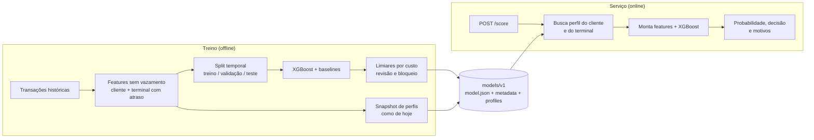
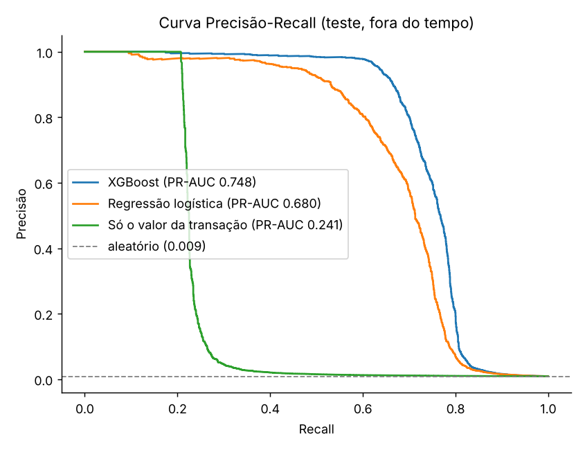
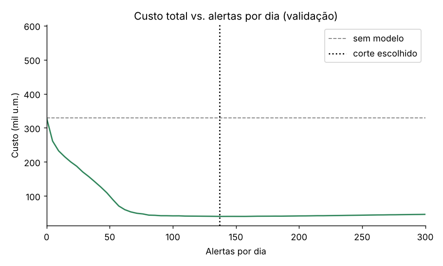
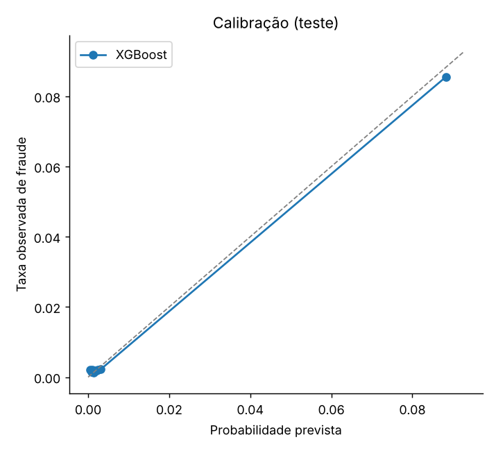
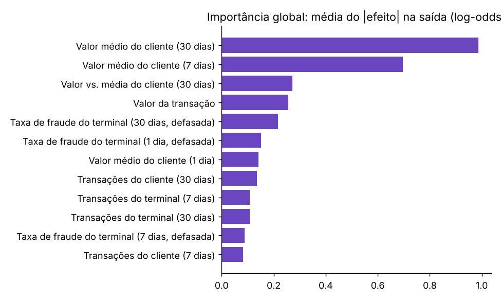
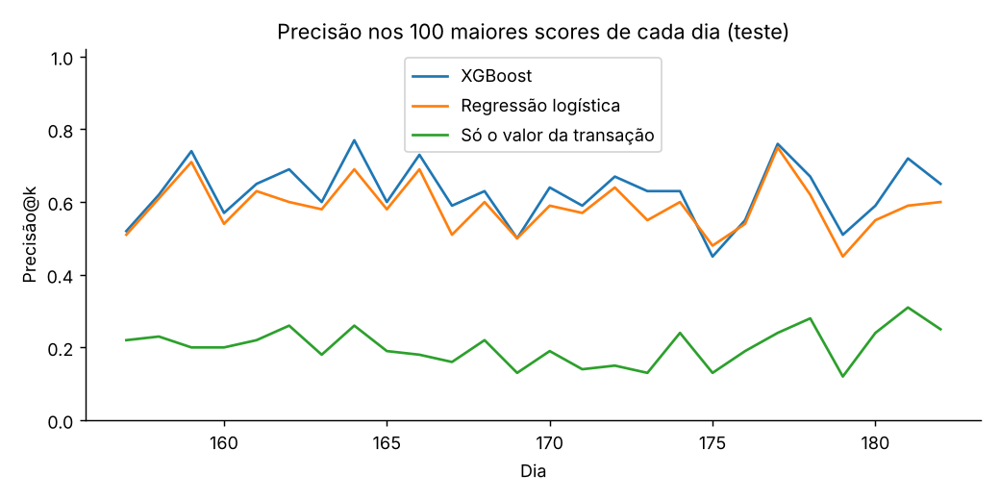
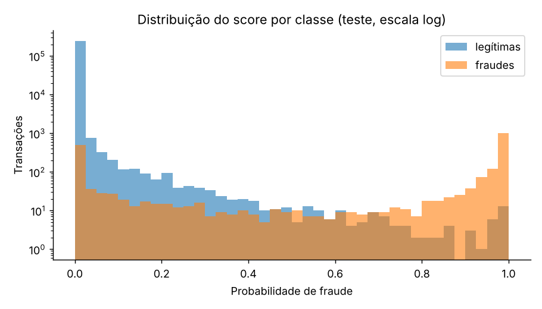

# Detecção de fraude em cartões: do modelo à API (FastAPI + Docker + Cloud Run)

 

> **EN summary.** End-to-end card-fraud project: leakage-safe behavioural features (customer/terminal history with a 7-day label delay), **out-of-time** validation, a **cost-based decision policy** (approve / review / block), per-transaction **explanations** (native SHAP), and a **FastAPI scoring service** packaged with Docker for Cloud Run. Trained on the *Fraud Detection Handbook* **simulated** dataset (1.75M transactions). Includes tests for data leakage and training-serving skew.

## O que este projeto demonstra

- **Features sem vazamento.** Todo histórico é calculado "como no início do dia" e os rótulos de fraude só entram com **7 dias de atraso** (o tempo real para uma fraude ser confirmada). Há testes que quebram se isso for violado.
- **Validação fora do tempo.** Treino, validação e teste são períodos consecutivos, com intervalo de 7 dias entre eles, em vez de um split aleatório.
- **Decisão por custo, não por 0,5.** Os limiares de revisão e bloqueio vêm do custo (valor fraudado perdido + custo por alerta) e da precisão exigida, definidos na validação e aplicados no teste.
- **Explicabilidade.** Cada resposta da API traz os 3 fatores que mais pesaram (contribuições SHAP nativas do XGBoost).
- **Produção.** API FastAPI com validação de entrada, tratamento de *cold start*, artefato **sem pickle** (`model.json` + `metadata.json` + `profiles.npz`), Dockerfile e CI.
- **Sem *training-serving skew*.** Um teste garante que as features calculadas no treino são idênticas às calculadas pela API.

## Dados

**Dados simulados** do *Fraud Detection Handbook*: 1.754.155 transações, 4.990 clientes, 10.000 terminais, abril a setembro de 2018, 0,84% de fraudes, com três cenários de fraude (valor alto, terminal comprometido, cartão comprometido). Detalhes, licença e como baixar em [`data/README.md`](data/README.md).

> Por serem simulados, **os resultados abaixo não representam o desempenho em fraude real**: os padrões do simulador são mais simples e estáveis que os de fraudadores reais.

## Arquitetura



O snapshot de perfis funciona como uma *feature store* atualizada diariamente: a API consulta o histórico agregado de cada cliente e terminal e combina com os dados da transação recebida.

## Resultados (período de teste, fora do tempo)

Treino: 728.196 transações (0,88% fraude) · Validação: 287.588 · Teste: 249.527 (0,88% fraude).

| Modelo | PR-AUC | ROC-AUC | Precisão@100/dia | Valor fraudado capturado@100/dia |
|---|---|---|---|---|
| **XGBoost** | **0.748** | **0.899** | **0.626** | **88.6%** |
| Regressão logística | 0.680 | 0.891 | 0.588 | 83.9% |
| Só o valor da transação | 0.241 | 0.646 | 0.202 | 65.7% |

*Precisão@100/dia* é a precisão entre os 100 maiores scores de cada dia (capacidade de investigação de um time de analistas). A PR-AUC de um modelo aleatório seria ~0,009.

### Política de decisão

Limiares escolhidos na **validação** e aplicados no **teste**:

- **Revisar** se probabilidade ≥ 0.0306 (mínimo custo) e **bloquear** se ≥ 0.3760 (precisão de pelo menos 90% na validação; no teste, a precisão dos bloqueios foi 89.1%).
- Cerca de **139 alertas por dia**, dos quais ~64 são bloqueios automáticos. Precisão dos alertas: **47.0%**; fraudes detectadas (em quantidade): **77.2%**; **90.3% do valor fraudado** capturado.
- **Redução de custo de 87.7%** contra não ter modelo (na validação: 87.9%, ou seja, o limiar se mantém no período seguinte).

> Premissas **ilustrativas**: cada alerta custa 2 u.m., uma fraude não detectada custa o valor da transação e um alerta evita a perda inteira. Não há custo de atrito com o cliente. Ajuste em [`config.py`](src/fraud/config.py).

| | |
|---|---|
|  |  |
|  |  |
|  |  |

### Leitura

- O XGBoost supera a regressão logística (PR-AUC 0.748 vs. 0.680) e, principalmente, a regra de olhar só o valor (0.241): o comportamento do cliente e o risco do terminal são o que agrega.
- A curva de custo **achata** depois de ~80 alertas por dia: um time com capacidade de 100 alertas diários perde pouco em relação ao corte de mínimo custo.
- A curva Precisão-Recall tem um "patamar" perto de 80% de recall. O diagnóstico por cenário (`reports/results.md`) mostra a origem: o recall é 100% para valores altos, 89.9% para cartão comprometido e **69.2% para terminal comprometido**. É consequência direta da defasagem de 7 dias: nos primeiros dias de um terminal comprometido, o histórico ainda não registra as fraudes, porque os rótulos só chegam depois. É o preço de modelar o atraso real de confirmação; um próximo passo seria complementar com regras de velocidade em tempo real.
- As variáveis mais importantes são `cust_avg_amt_30` e `cust_avg_amt_7`. Isso reflete o cenário de cartão comprometido do simulador (valores 5x maiores por 14 dias), então **não deve ser lido como regra de negócio real**.
- PSI do score validação vs. teste: 0.0001 (estável).

## API

```bash
make api        # ou: MODEL_DIR=models/v1 uvicorn fraud.api:app --port 8080
# documentação interativa em http://localhost:8080/docs
```

```bash
curl -s -X POST localhost:8080/score -H "Content-Type: application/json" -d '{
  "transaction_id": "demo-1", "customer_id": 0, "terminal_id": 6895,
  "amount": 310.0, "timestamp": "2018-10-01T03:12:00"}'
```

Resposta (valores reais do modelo treinado; o campo `latency_ms` varia):

```json
{
  "transaction_id": "demo-1",
  "fraud_probability": 0.381154,
  "decision": "BLOCK",
  "reasons": [
    {"feature": "amount_ratio_30", "label": "Valor vs. média do cliente (30 dias)", "value": 5.0399, "impact": 3.0263, "direction": "aumenta o risco"},
    {"feature": "amount", "label": "Valor da transação", "value": 310.0, "impact": 2.9736, "direction": "aumenta o risco"},
    {"feature": "term_risk_7", "label": "Taxa de fraude do terminal (7 dias, defasada)", "value": 1.0, "impact": 0.9813, "direction": "aumenta o risco"}
  ],
  "cold_start": {"customer": false, "terminal": false},
  "model_version": "v0.1.0",
  "latency_ms": 1.6
}
```

| Endpoint | Função |
|---|---|
| `POST /score` | Pontua uma transação |
| `POST /score/batch` | Pontua até 500 transações |
| `GET /health` | Estado do serviço e data do snapshot |
| `GET /model-info` | Versão, limiares, premissas de custo e métricas de teste |

Clientes ou terminais sem histórico são pontuados normalmente e sinalizados em `cold_start`.

**Latência** (medida por `scripts/benchmark_api.py`, 1 worker, localhost, **ambiente de 1 CPU, não é produção**): p50 de 3.0 ms, p95 de 3.6 ms e p99 de 4.3 ms por requisição (o cálculo no servidor leva ~1.4 ms); ~332 req/s em um cliente síncrono; lote de 100 transações em ~35 ms.

## Como rodar

```bash
git clone https://github.com/AndreMarques2002/fraud-detection-api.git
cd fraud-detection-api
python -m venv .venv && source .venv/bin/activate     # Windows: .venv\Scripts\activate
pip install -r requirements.txt && pip install -e .

python scripts/download_data.py                         # baixa os dados simulados (~100 MB)
python -m fraud.train --data data/raw/transactions.parquet   # treina e gera models/v1 e reports/
pytest -q
uvicorn fraud.api:app --port 8080                       # MODEL_DIR padrão: models/v1
streamlit run app/streamlit_app.py                      # demo interativa
```

(No Linux/macOS há atalhos: `make data`, `make train`, `make test`, `make api`, `make app`.) O treino leva cerca de 1 minuto. `python -m fraud.train --synthetic` roda com dados sintéticos só para demonstração.

**Docker:**

```bash
docker build -t fraud-api .
docker run --rm -p 8080:8080 fraud-api
```

**Google Cloud Run:** veja [`docs/deploy_cloud_run.md`](docs/deploy_cloud_run.md).

## Decisões de projeto

| Decisão | Motivo |
|---|---|
| Rótulos defasados em 7 dias nas features do terminal | Em produção a fraude só é confirmada dias depois; usar o rótulo do mesmo dia seria vazamento e inflaria as métricas |
| Split temporal com intervalo entre períodos | Um split aleatório mistura passado e futuro; o intervalo evita usar rótulos ainda desconhecidos |
| Sem SMOTE nem pesos de classe | Mantém probabilidades próximas das reais, necessárias para escolher limiares por custo |
| PR-AUC e Precisão@k em vez de acurácia | Com 0,84% de fraude, acurácia não diz nada; o negócio opera com capacidade limitada de análise |
| Dois limiares (revisar e bloquear) | Bloqueio automático exige alta precisão; revisão humana tolera mais falsos positivos |
| Artefato sem pickle (JSON + NPZ) | Evita execução de código ao carregar o modelo e facilita auditoria e versionamento |
| Snapshot diário de perfis | Mesmo cálculo no treino e na API, sem *training-serving skew* (há teste) |

## Limitações

- **Dados simulados:** o desempenho em fraude real seria diferente (fraudadores se adaptam, rótulos são ruidosos e atrasados, há *concept drift*).
- **Features diárias:** o snapshot não captura rajadas dentro do mesmo dia (*velocity* em minutos), que exigiria *streaming*.
- **Custo ilustrativo:** sem custo de atrito com o cliente legítimo bloqueado, nem custo de investigação variável.
- **Retreino:** o modelo foi treinado com dados até o período de treino; em produção seria retreinado periodicamente (rotina não incluída).
- **Não verificado por mim neste repositório:** o build da imagem Docker e o deploy no Cloud Run (o CI do GitHub constrói a imagem e testa a API). A demo Streamlit foi testada em modo headless.
- Sem autenticação nem *rate limiting* na API (no Cloud Run, use autenticação por IAM).

## Estrutura

```
src/fraud/
  features.py    features sem vazamento (histórico, defasagem, snapshot)
  metrics.py     PR-AUC, Precisão@k/dia, custo e limiares
  model.py       XGBoost e baseline logístico
  explain.py     motivos por transação e importância global
  artifact.py    salvar/carregar artefato sem pickle
  serving.py     Scorer (perfil + features + decisão + motivos)
  api.py         FastAPI
  train.py       pipeline de treino e avaliação (CLI)
scripts/         download_data.py, benchmark_api.py
app/             demo Streamlit
tests/           vazamento, skew treino/serving, métricas e API
models/v1/       artefato treinado (versionado: ~1 MB)
reports/         resultados, métricas e gráficos
MODEL_CARD.md    finalidade, limites, monitoramento e governança
```

## Licença

MIT. Os dados seguem os termos do repositório de origem (veja `data/README.md`).
